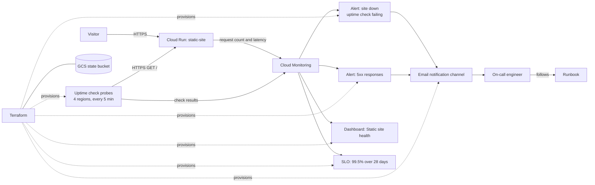

# Monitoring and Incident Response on Google Cloud

Production-style monitoring for a Cloud Run website, defined in Terraform and validated with a real game-day exercise: I deployed a broken release on purpose, responded from the alerts and runbook, rolled back, and wrote a blameless postmortem.

This project monitors the site from [Project 1: Static Site on Cloud Run](https://github.com/akmiranda305-CloudEng/gcp-cloudrun-site).

## Architecture


## How it works

Terraform provisions all of the monitoring for the Cloud Run site. Uptime check probes in four regions request the site's home page every five minutes, and Cloud Run reports its own request count and latency. Both streams of data flow into Cloud Monitoring, which feeds four things: a dashboard showing request rates by response class, latency, and uptime; an availability SLO targeting 99.5% of requests over 28 days; and two alert policies, one that fires when the uptime check fails from more than one location and one that fires on any 5xx response. When an alert fires, it sends an email through a notification channel to the on-call engineer, who follows the runbook to confirm the problem, find the recent change, and roll back. I tested this chain by deliberately deploying a broken release: the alert fired about four minutes later, and the full write-up is in the postmortem.

## What it monitors

| Component | What it does |
|---|---|
| Uptime check | Requests the site's home page over HTTPS every 5 minutes from multiple regions |
| Alert: site down | Fires when the uptime check fails from more than one location, which reduces false alarms from a single flaky probe |
| Alert: 5xx responses | Fires when Cloud Run returns any 5xx response in a 5-minute window |
| Dashboard | Requests per second by response class, 95th-percentile latency, and uptime check success |
| SLO | 99.5% of requests succeed (non-5xx) over a rolling 28 days |
| Notification channel | Sends alert and resolution emails |

Everything above is defined in Terraform. The state bucket and API enablement were created manually.

## Game-day exercise

I deployed a container image that returns HTTP 500 for every request, then responded as if I were on call.

- **Time to detect:** about 4 minutes
- **User impact:** about 14 minutes of failed requests
- **Recovery:** redeployed the previous image, one command
- **Notifications:** alert and resolution emails both arrived

Read the full write-up: [Postmortem](docs/postmortems/2026-11-16-bad-deploy.md). The steps I followed are in the [Runbook](docs/runbook.md).

[Optional: add one or two screenshots here, such as the dashboard during the incident and the incident list. Blur your email address first.]

## Design decisions

- **Alert on failures from more than one location:** a single failed probe doesn't page anyone.
- **Alert on a count of 5xx responses instead of an error ratio:** the site has very little traffic, so ratios are unstable.
- **5-minute check period:** keeps executions well inside the free allotment, at the cost of slower detection. The postmortem lists shortening it as an action item.
- **Few alert conditions:** alerting is the one line item here that adds cost, so I kept it to what I could justify.
- **Read the Cloud Run service with a data source:** this project doesn't hard-code the site's URL.
- **Separate state path:** this project's Terraform state uses its own prefix in the shared state bucket, so it can't collide with Project 1.
- **Rollback by redeploying the previous image:** pinning traffic to an old revision can stop later automatic deploys from taking effect.

## Repository layout

```
terraform/     Uptime check, alerts, dashboard, SLO, notification channel
docs/runbook.md
docs/postmortems/
```

## Deploying it yourself

Prerequisite: the Cloud Run service from Project 1 is running (service name `static-site` in `us-central1`, or override the variables).

1. Enable the Monitoring API: `gcloud services enable monitoring.googleapis.com`
2. Use a versioned GCS bucket for Terraform state
3. Copy `terraform/terraform.tfvars.example` to `terraform/terraform.tfvars` and fill in your project ID and email address
4. Initialize and apply:
   ```bash
   cd terraform
   terraform init -backend-config="bucket=YOUR-STATE-BUCKET"
   terraform plan
   terraform apply
   ```

## Challenges and what I learned

- **A placeholder email caused configuration drift.** The notification channel was first created from an example value, and a later manual edit in the console made it differ from my code. `terraform plan` showed the difference before I applied it, so I fixed the code instead of the console. Alerts weren't reaching me until I did.
- **My first draft of the 5xx alert was wrong.** It had a filter with no values and a resource name that duplicated an existing one. Reviewing it line by line and running `terraform validate` caught both.
- **Running commands from the wrong directory.** `terraform validate` reported "Success" in an empty folder, which proved nothing. I now check `pwd` before running anything with relative paths.
- **Cloud Shell lost credentials twice** (an empty token, then "no active account"). I diagnosed it with `gcloud auth list`, re-authenticated, and added the fix to the runbook.
- **The SLO was misleading at low traffic.** A few failed requests used up the entire error budget, which is why the postmortem proposes an absolute-count alert.

## Cost

As of November 17, 2026, net spend across both portfolio projects (they share one GCP project) is $0.00. Usage is within Google Cloud's free tier. The cost I'm watching is alerting, since alert conditions are the one new billable item here; I kept it to two conditions on purpose. I check the billing report weekly and have a budget alert set.

## Future improvements

- Add a post-deploy smoke test to the Project 1 pipeline that fails the deploy if the new revision doesn't return 200
- Shorten the uptime check period to 1 minute
- Add an absolute-count alert, or lengthen the SLO window
- Add a latency alert
